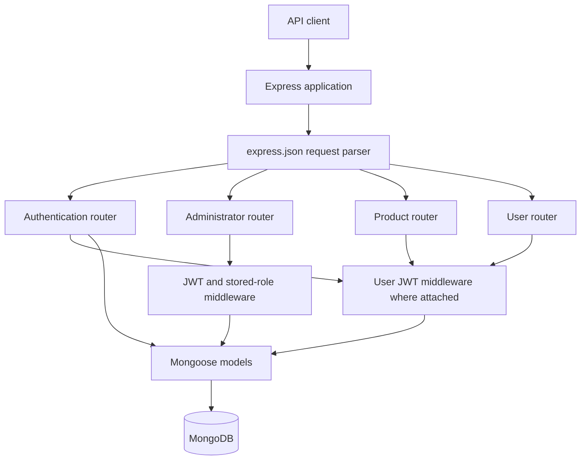
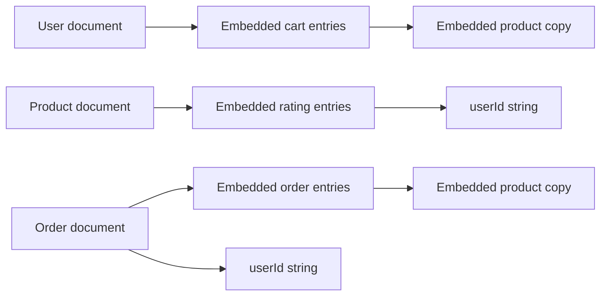

# Kudumbhasreekart — Detailed Backend Code Study

> Analysis date: **12 October 2026**, Asia/Kolkata (IST, UTC+05:30).
> Source baseline: commit **`03687eb3f8fa0b99a6a6c702548385ee94b7ee0d`**, on local branch `master`.
> Method: inspection of every application source file, both package manifests, and available local Git history. This report describes the uploaded code as it exists; proposed changes are explicitly identified.

## Contents

1. [Scope and evidence](#1-scope-and-evidence)
2. [Git upload time and development range](#2-git-upload-time-and-development-range)
3. [Backend summary](#3-backend-summary)
4. [Repository structure and source inventory](#4-repository-structure-and-source-inventory)
5. [Dependencies and runtime configuration](#5-dependencies-and-runtime-configuration)
6. [Architecture and request lifecycle](#6-architecture-and-request-lifecycle)
7. [Startup and database connection](#7-startup-and-database-connection)
8. [Database models and relationships](#8-database-models-and-relationships)
9. [Authentication and authorization](#9-authentication-and-authorization)
10. [Complete API inventory](#10-complete-api-inventory)
11. [Authentication API walkthrough](#11-authentication-api-walkthrough)
12. [Product API walkthrough](#12-product-api-walkthrough)
13. [User, cart, address, and order API walkthrough](#13-user-cart-address-and-order-api-walkthrough)
14. [Administrator API walkthrough](#14-administrator-api-walkthrough)
15. [End-to-end flows](#15-end-to-end-flows)
16. [Checkout integrity analysis](#16-checkout-integrity-analysis)
17. [Analytics correctness analysis](#17-analytics-correctness-analysis)
18. [Validation, errors, and response contracts](#18-validation-errors-and-response-contracts)
19. [Security findings](#19-security-findings)
20. [Performance and scalability](#20-performance-and-scalability)
21. [Operational and maintainability assessment](#21-operational-and-maintainability-assessment)
22. [Prioritized improvement plan](#22-prioritized-improvement-plan)
23. [Verification and regression scenarios](#23-verification-and-regression-scenarios)
24. [Running and studying the project](#24-running-and-studying-the-project)
25. [File-by-file reference](#25-file-by-file-reference)
26. [Final assessment and limitations](#26-final-assessment-and-limitations)

## 1. Scope and evidence

The repository contains a Node.js/Express backend for an e-commerce application. The review covers all **11 JavaScript source files**, **618 JavaScript lines**, the **22-line `package.json`**, and the **3,962-line `package-lock.json`**. The uploaded commit contains **13 tracked files and 4,602 inserted lines**, including lockfile metadata. Line counts include comments and blank lines; they are not counts of executable statements.

There are **19 explicitly registered HTTP endpoints**: 4 authentication/account endpoints, 4 product endpoints, 5 user/cart/order endpoints, and 6 administrator endpoints.

Evidence categories used throughout:

- **Implemented behavior:** directly visible in the repository.
- **Derived consequence:** follows from the control flow, schema, or queries, but has not been reproduced against a running database in this review.
- **Recommendation:** a proposed improvement, not something already implemented.
- **Unknown:** information the available source/history cannot establish.

Source links are relative to this document so the report can travel with the repository. Line numbers refer to the reviewed baseline. Database credentials are intentionally not reproduced in this document; their location and implications are documented.

No application code was changed for this analysis. No external database was contacted. No authentication tokens were generated, and no real account, product, cart, or order was modified.

## 2. Git upload time and development range

### 2.1 Available Git evidence

| Item | Observed value |
|---|---|
| Repository remote | `https://github.com/kishore-bot/kudumbhasreekart.git` |
| Current local branch | `master` |
| Available remote-tracking branch | `origin/master` |
| Remote default reference | `origin/HEAD -> origin/master` |
| Reachable commits across available references | **1** |
| Shallow repository | **No** |
| Available tags | None |
| Commit hash | `03687eb3f8fa0b99a6a6c702548385ee94b7ee0d` |
| Commit author / committer | KISHORE K |
| Commit message | `uploading server` |
| Author timestamp | **2022-09-13 19:26:21 +05:30** |
| Committer timestamp | **2022-09-13 19:26:21 +05:30** |
| Same timestamp in UTC | **2022-09-13 13:56:21 UTC** |
| Earliest available commit | 13 September 2022, 7:26:21 PM IST |
| Latest available commit | 13 September 2022, 7:26:21 PM IST |
| Observed first-to-last commit interval | **0 seconds** |
| Local clone reflog event | **2026-10-12 23:07:21 +05:30** |

### 2.2 What “time range on Git” establishes

The available history records a **single snapshot upload commit on 13 September 2022**. All models, middleware, routes, startup code, and dependency manifests entered the available history together in that commit.

The zero-second interval means the first and last available commit are the same event. It **does not mean that the backend was developed in zero seconds**, in one session, or on that day. There are no earlier intermediate commits from which to reconstruct coding sessions or module completion dates.

A commit's author and committer timestamps are Git metadata, not server-side push receipt timestamps. The message `uploading server` supports describing the commit as an upload snapshot, but the exact time it reached GitHub is not recorded in the local Git log. Git timestamps can also be set by the commit creator; they are not an independent time-tracking system.

The October 2026 reflog entry records this local clone. File modification times around the clone date are checkout metadata and should not be used as the original development dates.

### 2.3 Development chronology that can be stated

| Stage | Evidence | Interpretation |
|---|---|---|
| Coding before the snapshot | Not recorded | Start date, hours spent, and implementation order are unknown. |
| Snapshot committed | Single commit, 13 September 2022 | Complete visible backend added together. |
| Later development in available references | No additional commits | No later changes can be reconstructed from this checkout. |
| Local review copy created | Clone reflog, 12 October 2026 | Date of this local copy, separate from original development. |
| This report | 12 October 2026 | Analysis of the available snapshot. |

To recover a longer historical range, additional evidence would be needed: another repository, branches not present here, archived commits, GitHub activity records, deployment records, or the original development folder. This review did not fetch remote changes or inspect GitHub separately; the history conclusions apply to the available local references.

### 2.4 Reproduce the history inspection

```powershell
git log --all --reverse --format="%H | %aI | %cI | %s"
git rev-list --all --count
git rev-parse --is-shallow-repository
git show --stat 03687eb
git branch -a
git reflog --date=iso
```

## 3. Backend summary

The backend supports registration and sign-in, JWT authentication, category-based product browsing, name search, product ratings, a rating-based featured product, a persistent shopping cart, address storage, order placement, personal order history, administrator catalog operations, order status changes, and earnings summaries.

It is a compact monolithic service: Express route handlers contain both HTTP handling and business logic, and access MongoDB directly through Mongoose. There is no separate controller, service, repository, or background worker layer.

| Area | Implementation |
|---|---|
| HTTP server | Express 4, JSON request parsing |
| Persistence | MongoDB through Mongoose 6 |
| Account passwords | bcrypt hashes, cost argument `8` |
| Authentication | JWT in the custom `x-auth-token` request header |
| Administrator checks | Database user lookup, followed by exclusion of two role strings |
| Cart persistence | Embedded product copies inside user documents |
| Order persistence | Embedded product copies inside order documents |
| Inventory | Numeric `Product.quantity`, decremented during order placement |
| Earnings | JavaScript loops over saved order product copies |
| API structure | Mostly `/api/*`, with `/admin/*`, `/tokenIsValid`, and `/` exceptions |
| Configuration | `PORT` environment variable; database URI and JWT signing key in source |

The project has the core functional pieces of a small e-commerce backend, but several integrity and access-control gaps need attention before relying on it for real orders or sensitive account data.

## 4. Repository structure and source inventory

```text
kudumbhasreekart/
├── index.js                 # Express setup, route mounting, MongoDB connection
├── package.json             # Project metadata, scripts, dependency ranges
├── package-lock.json        # Locked dependency graph
├── middlewares/
│   ├── auth.js              # Verify a user JWT
│   └── admin.js             # Verify JWT and inspect the stored user role
├── models/
│   ├── user.js              # Account and embedded shopping cart
│   ├── product.js           # Product model and reusable product schema
│   ├── rating.js            # Reusable embedded rating schema
│   └── order.js             # Order and embedded purchased products
└── routes/
    ├── auth.js              # Signup, signin, token check, account retrieval
    ├── product.js           # Browse, search, rate, featured product
    ├── user.js              # Cart, address, checkout, own orders
    └── admin.js             # Products, orders, status, analytics
```

| File | Lines | Main responsibility |
|---|---:|---|
| [index.js](index.js) | 35 | Application bootstrap |
| [middlewares/auth.js](middlewares/auth.js) | 23 | JWT verification |
| [middlewares/admin.js](middlewares/admin.js) | 27 | JWT verification and role check |
| [models/user.js](models/user.js) | 47 | User schema/model |
| [models/product.js](models/product.js) | 37 | Product schema/model |
| [models/rating.js](models/rating.js) | 14 | Rating subdocument schema |
| [models/order.js](models/order.js) | 37 | Order schema/model |
| [routes/auth.js](routes/auth.js) | 80 | 4 account/authentication routes |
| [routes/product.js](routes/product.js) | 79 | 4 product routes |
| [routes/user.js](routes/user.js) | 121 | 5 user routes |
| [routes/admin.js](routes/admin.js) | 118 | 6 administrator routes plus analytics helper |

No tracked frontend, test suite, README, deployment manifest, environment template, migrations, or CI workflow is present in the reviewed snapshot.

## 5. Dependencies and runtime configuration

### 5.1 Manifest and locked versions

| Package | Declared range | Version in lockfile | Usage in this source |
|---|---|---|---|
| `express` | `^4.18.1` | `4.18.1` | Application, routers, JSON middleware |
| `mongoose` | `^6.3.2` | `6.3.2` | Schemas, models, queries, connection |
| `bcryptjs` | `^2.4.3` | `2.4.3` | Hash passwords and compare signin input |
| `jsonwebtoken` | `^8.5.1` | `8.5.1` | Sign and verify JWTs |
| `http` | `^0.0.1-security` | `0.0.1-security` | Declared but never imported |
| `nodemon` | `^2.0.16` | `2.0.16` | Development restart script |

The lockfile uses **lockfile version 2** and contains **217 package entries**, excluding the root package entry. This includes transitive and development dependencies; it does not mean there are 217 application features or direct dependencies.

The separate npm dependency named `http` is not used in this application. Node's built-in HTTP functionality is available without adding that package; review removing this unused dependency.

### 5.2 Package scripts

```json
{
  "start": "node ./index.js",
  "dev": "nodemon ./index.js"
}
```

- `npm start` launches the service.
- `npm run dev` launches the same entrypoint with restart-on-change behavior.
- There is no `test`, `lint`, `build`, or deployment script.
- Application modules use CommonJS `require()` and `module.exports`.
- Root package metadata: name `server`, version `1.0.0`, license `ISC`; description and author fields are empty.

### 5.3 Runtime requirements and configuration gaps

`package.json` declares no Node engine version. The locked Mongoose package declares Node `>=12.0.0`; that is a dependency compatibility floor, **not a recommendation to deploy an old Node release**. A runtime choice should be documented and validated against the project before deployment.

| Setting | Current implementation | Consequence |
|---|---|---|
| Port | `process.env.PORT || 10000` | A hosting platform can supply `PORT`. |
| Listen address | `0.0.0.0` | Server listens on all available interfaces. |
| MongoDB URI | Literal in `index.js:14` | Credentials/configuration are tied to the source snapshot. |
| Local MongoDB alternative | Comment at `index.js:15` | Switching requires a source edit. |
| JWT signing key | Literal repeated in auth routes and middleware | No environment-based secret or rotation mechanism. |
| Database name | No explicit name in URI path or connection options | The intended application database is not documented; confirm driver-selected behavior in a test environment. |

No current dependency vulnerability scan was performed. The versions above describe the lockfile, not the security status or latest available versions of those packages.

## 6. Architecture and request lifecycle

### 6.1 Component flow



The diagram describes logical paths. Express tries the mounted routers in source order: authentication, administrator, product, then user. Routers are mounted at the application root with `app.use(router)`; each router already defines its complete endpoint paths.

### 6.2 Typical authenticated request

1. Express accepts the HTTP request.
2. `express.json()` parses a matching JSON body.
3. A registered route matches the method and URL.
4. `auth` reads `x-auth-token` and verifies the signature.
5. The middleware attaches the token payload's ID to `req.user` and the supplied token to `req.token`.
6. The route handler reads parameters/body/query fields and calls Mongoose directly.
7. The handler usually returns a document, document array, or computed object with `res.json()`.
8. Most caught exceptions become HTTP 500 with `{ "error": "..." }`.

The regular `auth` middleware performs no database lookup. It confirms a JWT signature, but does not itself confirm that the account still exists or has an allowed role.

### 6.3 Code organization tradeoffs

The direct route-to-model structure is easy to follow at this scale. However, checkout and analytics business rules are coupled to HTTP handlers, making them harder to test independently, reuse, or change consistently. Error formatting, null checks, role checks, and response filtering are repeated or missing across handlers.

There is no separate payment service, inventory reservation system, image storage service, email service, or fulfillment integration in this repository.

## 7. Startup and database connection

Source: [index.js](index.js), lines 1–35.

1. Import Express, Mongoose, and all four routers.
2. Select port from the environment or default to `10000`.
3. Create the Express app.
4. Assign a MongoDB Atlas connection URI to `DB`.
5. Install the JSON parser and routers.
6. Start `mongoose.connect(DB)` and register success/error callbacks.
7. Call `app.listen(PORT, "0.0.0.0", ...)` immediately, without awaiting database connection success.

### 7.1 Startup behavior under database failure

The HTTP listener can start before the database is ready. A database connection error is logged, but there is no explicit shutdown, readiness state, or failure exit. Consequently, a platform may see a listening service while database-backed requests buffer, time out, or fail.

This is a consequence of the separate asynchronous connection and listener calls; it was not tested against the configured database.

### 7.2 Missing lifecycle facilities

- No dedicated health or readiness endpoint.
- `GET /` is an authenticated account-data route, not a public health probe.
- No shutdown handler for `SIGTERM` or `SIGINT`.
- No configured request logging, request ID, or centralized application logger.
- No separate app export for in-process HTTP testing.
- No explicit database connection timeout/retry policy in application code.

**Recommendation:** initialize validated configuration, establish the database connection, then listen; expose readiness separately and close the HTTP server/database connection during shutdown.

## 8. Database models and relationships

### 8.1 Data relationship overview



These are **embedded schemas and string IDs**, not declared Mongoose `ref` relationships. There is no `populate()` use and no schema-level foreign-key enforcement.

The code defines three top-level models: `User`, `Product`, and `Order`. `ratingSchema` is exported as a schema only; it has no standalone model or collection. Mongoose's normal collection-name conventions would map these models to users/products/orders unless configured elsewhere; no override appears here.

None of the schemas enables automatic `createdAt`/`updatedAt` timestamps. Default Mongoose document/subdocument IDs and version metadata may appear in serialized output because no custom serialization or `_id` suppression is configured.

### 8.2 User model

Source: [models/user.js](models/user.js), lines 4–44.

| Field | Type | Required | Default / handling | Notes |
|---|---|---|---|---|
| `name` | String | Yes | Trimmed | No explicit length restriction. |
| `email` | String | Yes | Trimmed; regex validator | No `unique` index or lowercase normalization declared. |
| `password` | String | Yes | Route stores bcrypt hash | No `select: false`; returned by ordinary serialization. |
| `address` | String | No | `""` | Single unstructured address string. |
| `type` | String | No | `"user"` | No enum restricting allowed role values. |
| `cart` | Array of embedded entries | No | Array schema | Each entry holds a product copy and quantity. |
| `cart[].product` | Embedded `productSchema` | No explicit required flag | Copied from a product document | Not a reference to the live product. |
| `cart[].quantity` | Number | Yes | None | No minimum, maximum, or integer validation. |

Signup explicitly assigns only `name`, `email`, and the hashed password. A request field such as `type: "admin"` is not passed into the new user by that route. Thus the signup code does **not** directly expose role assignment, even though the schema and administrator check remain weak.

The email regex checks formatting when a user document is validated. The preliminary duplicate lookup uses the request's raw email value, before schema trimming. Without a unique index, simultaneous signups or normalization differences can still produce duplicate logical accounts.

### 8.3 Product model

Source: [models/product.js](models/product.js), lines 4–34.

| Field | Type | Required | Handling | Missing constraints |
|---|---|---|---|---|
| `name` | String | Yes | Trimmed | Length and uniqueness |
| `description` | String | Yes | Trimmed | Length limits |
| `images` | Array of strings | Individual entries marked required | Stored strings | URL format, allowed schemes, minimum array length |
| `quantity` | Number | Yes | Inventory count | Nonnegative integer constraint |
| `price` | Number | Yes | Product price | Nonnegative range and currency/precision policy |
| `category` | String | Yes | Exact category label | Enum or normalization |
| `ratings` | Array of `ratingSchema` | No | Embedded user scores | Array size and per-user uniqueness enforcement |

The schema exports both `Product` and `productSchema`. The schema is reused inside users' carts and orders. Images are plain strings; no upload, download, image validation, or storage management is implemented.

Category values are not limited to the five analytics categories. Administrators can create products in other categories; these still contribute to overall earnings but have no dedicated response field in the current category summary.

### 8.4 Rating schema

Source: [models/rating.js](models/rating.js), lines 3–12.

| Field | Type | Required | Meaning |
|---|---|---|---|
| `userId` | String | Yes | ID copied from the authenticated JWT |
| `rating` | Number | Yes | Submitted score |

There is no declared rating range such as 1–5, integer-only check, timestamp, or compound uniqueness rule. The intended one-rating-per-user behavior is implemented by an array loop in the rating route.

### 8.5 Order model

Source: [models/order.js](models/order.js), lines 4–34.

| Field | Type | Required | Default / meaning |
|---|---|---|---|
| `products` | Array of embedded entries | No explicit nonempty constraint | Purchased line items |
| `products[].product` | Embedded `productSchema` | No explicit required flag | Product copy loaded at checkout |
| `products[].quantity` | Number | Yes | Ordered quantity; no positive integer constraint |
| `totalPrice` | Number | Yes | Client-supplied total stored without recalculation |
| `address` | String | Yes | Client-supplied delivery address |
| `userId` | String | Yes | Authenticated user ID |
| `orderedAt` | Number | Yes | Server epoch milliseconds |
| `status` | Number | No | `0` |

The code does not define what status numbers mean. Labels such as pending, shipped, delivered, or cancelled would be a client convention or a future design decision, not an established backend enum.

### 8.6 Snapshot behavior and its implications

- A cart entry stores the product's data at insertion. Later product price, description, inventory, image, or rating changes do not automatically refresh the embedded copy.
- Adding more units of an already-present cart item increments quantity but does not replace its embedded product copy.
- Checkout reloads each product from the product collection, so its saved order copy uses database product data rather than the client's submitted price.
- The order copy is built **after the handler decrements inventory**. Its embedded `product.quantity` represents the remaining inventory at that step, while the sibling line `quantity` represents units purchased.
- Product deletion leaves earlier cart/order copies in place. Historical order copies remain available, but cart removal currently requires the live product and can fail after deletion.
- Each embedded product also copies its ratings array. This increases cart/order size without being necessary for basic checkout or order history.

**Recommendation:** use a compact live-product reference in the cart and an explicit immutable purchase snapshot in orders, with fields such as product ID, name, unit price, currency, and category. Keep purchased quantity separate from inventory.

## 9. Authentication and authorization

### 9.1 Regular authentication middleware

Source: [middlewares/auth.js](middlewares/auth.js), lines 3–20.

The middleware reads `req.header("x-auth-token")`. Missing tokens return HTTP 401 with a `msg` field. Existing tokens are verified with the hardcoded signing key. On success, the payload's `id` becomes `req.user`, and the original token becomes `req.token`.

Important behavior:

- The API expects the raw JWT in `x-auth-token`; it does not read `Authorization: Bearer ...`.
- Signature verification is not accompanied by payload shape validation.
- No account lookup occurs here.
- No token issuer, audience, explicit algorithm allowlist, or expiry requirement is configured in the application calls.
- Invalid signature, malformed token, or an expired token supplied by a client causes verification to throw, which the catch converts to HTTP **500**.
- The `if (!verified)` branch attempts a 401 response, but common verification failures throw before that branch.

### 9.2 Administrator middleware

Source: [middlewares/admin.js](middlewares/admin.js), lines 4–24.

It verifies a JWT, loads `User.findById(verified.id)`, and rejects the account only when:

```javascript
user.type == "user" || user.type == "seller"
```

This is an exclusion check. A stored type of `"admin"` passes, but so does any other type that is neither `"user"` nor `"seller"`. A typo, custom role, or unexpected stored value can therefore receive administrator access.

The middleware does not handle a missing user before reading `user.type`; that case becomes a caught 500 error. It uses HTTP 401 for ordinary users/sellers even though a valid authenticated user denied permission would more conventionally receive 403.

**Recommendation:** require an existing user whose role explicitly equals the supported administrator role; define allowed roles in the schema and validate token payloads.

### 9.3 Password and token lifecycle

- Signup hashes passwords with `bcryptjs.hash(password, 8)`.
- Signin compares input against the stored hash using `bcryptjs.compare()`.
- Signin creates a token with `jwt.sign({ id: user._id }, signingKey)`.
- There is no `expiresIn` option, so issued tokens have no application-configured expiration claim.
- There is no refresh-token, logout/revocation, password-change, password-reset, account suspension, or email-verification workflow.
- Regular route access and `/tokenIsValid` differ: the token-check route looks up the user, while regular `auth` does not.

The database URI and JWT signing key are visible in committed code. This report does not copy either value. The database account should be rotated, and the JWT secret replaced and managed outside source control. Rotating the JWT key also invalidates tokens signed with the old key.

## 10. Complete API inventory

All successful handlers use `res.json()` without setting a creation status, so normal successful creation responses are **200**, not 201.

| # | Method | Path | Guard | Request data | Success response |
|---:|---|---|---|---|---|
| 1 | POST | `/api/signup` | None | `name`, `email`, `password` | User document |
| 2 | POST | `/api/signin` | None | `email`, `password` | User fields plus `token` |
| 3 | POST | `/tokenIsValid` | Inline JWT check | `x-auth-token` header | JSON boolean |
| 4 | GET | `/` | `auth` | Token header | User fields plus `token` |
| 5 | GET | `/api/products/` | `auth` | Query `category` | Product array |
| 6 | GET | `/api/products/search/:name` | `auth` | Path `name` | Product array |
| 7 | POST | `/api/rate-product` | `auth` | `id`, `rating` | Updated product |
| 8 | GET | `/api/deal-of-day` | `auth` | None | Highest rating-sum product if any |
| 9 | POST | `/api/add-to-cart` | `auth` | Product `id` | Updated user |
| 10 | DELETE | `/api/remove-from-cart/:id` | `auth` | Product path `id` | Updated user |
| 11 | POST | `/api/save-user-address` | `auth` | `address` | Updated user |
| 12 | POST | `/api/order` | `auth` | `cart`, `totalPrice`, `address` | New order |
| 13 | GET | `/api/orders/me` | `auth` | None | Current user's order array |
| 14 | POST | `/admin/add-product` | `admin` | `name`, `description`, `images`, `quantity`, `price`, `category` | New product |
| 15 | GET | `/admin/get-products` | `admin` | None | All products |
| 16 | POST | `/admin/delete-product` | `admin` | Product `id` | Deleted product, or `null` if no match |
| 17 | GET | `/admin/get-orders` | `admin` | None | All orders |
| 18 | POST | `/admin/change-order-status` | `admin` | Order `id`, numeric `status` | Updated order |
| 19 | GET | `/admin/analytics` | `admin` | None | Earnings object |

No dedicated get-product-by-ID, edit-product, set-cart-quantity, cancel-order, order-detail, payment, image-upload, or admin-account-creation route is registered.

## 11. Authentication API walkthrough

### 11.1 `POST /api/signup`

Source: [routes/auth.js](routes/auth.js), lines 9–32.

```json
{
  "name": "Example Buyer",
  "email": "buyer@example.com",
  "password": "example-only-password"
}
```

The handler destructures three fields, looks up an existing user by email, returns 400 if found, hashes the password, constructs a new user, saves it, and returns the saved document.

Defaults initialize the address and role; there is no token issued here. The caller must sign in separately to receive a JWT.

Failure behavior includes:

- Existing email: 400 with `msg`.
- Invalid/missing fields: hashing or Mongoose validation can fail and becomes 500.
- Parallel requests for the same email: a check-then-save race exists because no unique email index is declared.
- Successful output includes the stored password hash because the response serializes the full user document.

### 11.2 `POST /api/signin`

Source: [routes/auth.js](routes/auth.js), lines 36–57.

The handler finds the user by exact supplied email, returns 400 when absent, compares passwords, returns 400 on mismatch, signs a token, and returns `{ token, ...user._doc }`.

The output includes account fields, cart contents, and the password hash. Email-not-found and password-mismatch responses differ, which reveals whether an email is registered. There is no rate-limiting middleware in the repository.

### 11.3 `POST /tokenIsValid`

Source: [routes/auth.js](routes/auth.js), lines 59–72.

| Condition | Implemented result |
|---|---|
| Header missing | 200, JSON `false` |
| Verification succeeds and account exists | 200, JSON `true` |
| Verification succeeds but account is missing | 200, JSON `false` |
| Verification throws | 500, error object |

This endpoint is not a consistent “invalid means false” contract: malformed or invalid-signature tokens produce an error response instead of `false`.

### 11.4 `GET /`

Source: [routes/auth.js](routes/auth.js), lines 75–78.

After `auth`, the handler loads the user and returns `{ ...user._doc, token: req.token }`. It is the current-account endpoint and exposes the password hash.

This async handler has **no try/catch or explicit error-forwarding wrapper**. In the Express 4 structure used here, a rejected async operation is not routed to an application error handler by this code. A database error or null-user dereference can leave the request without a controlled response and may result in an unhandled rejection; exact process behavior depends on the runtime.

## 12. Product API walkthrough

### 12.1 `GET /api/products/?category=Food`

Source: [routes/product.js](routes/product.js), lines 6–13.

The query is:

```javascript
Product.find({ category: req.query.category })
```

It returns products whose category matches the supplied query value. There is no pagination, sort, projection, or category validation. Omitting `category` does not invoke an explicit all-products branch; the behavior of an undefined query value should be established in runtime tests rather than documented as guaranteed “all products.”

### 12.2 `GET /api/products/search/:name`

Source: [routes/product.js](routes/product.js), lines 17–27.

The name parameter becomes a case-insensitive MongoDB regular expression:

```javascript
{ name: { $regex: req.params.name, $options: "i" } }
```

A plain word can match part of a name. Regex metacharacters remain active: `.*` can match broadly, and invalid patterns can fail. User-controlled regex is not escaped or length-limited. Performance depends on pattern, dataset, indexes, and database behavior; no measured performance claim is made here.

There is no category restriction, pagination, or relevance ranking in this search route.

### 12.3 `POST /api/rate-product`

Source: [routes/product.js](routes/product.js), lines 30–53.

```json
{
  "id": "507f1f77bcf86cd799439011",
  "rating": 5
}
```

The handler loads a product, scans ratings, removes the first entry matching `req.user`, appends the new score, saves, and returns the product.

- Intended behavior is replacement of the current user's previous score.
- Only the first matching old entry is removed; already-existing duplicates are not fully repaired.
- No 1–5 range or integer rule is present.
- There is no purchase verification; any accepted authenticated user can rate a product.
- Missing products cause a null dereference; malformed IDs can cause cast errors, both reported as 500.
- Concurrent updates rely on document saves without an explicit atomic per-user-rating update strategy; conflicts or duplicated logical entries require runtime regression coverage.

### 12.4 `GET /api/deal-of-day`

Source: [routes/product.js](routes/product.js), lines 55–77.

The handler loads every product, sorts the array in memory using the **sum of its ratings**, then returns the first product.

For example:

| Product | Ratings | Sum | Average |
|---|---|---:|---:|
| A | `5, 5` | 10 | 5.0 |
| B | `3, 3, 3, 3` | 12 | 3.0 |

The current code selects **B**, because 12 exceeds 10. It does not select by highest average, discount, sales, recency, or a scheduled daily promotion.

Additional edge cases:

- Products with no ratings have a sum of zero.
- Equal sums never return comparator value `0`; the comparator returns `-1`, so ties have no deliberately stable policy.
- An empty catalog yields `products[0] === undefined`; the handler does not supply an explicit empty-state JSON contract.
- Sold-out products are not excluded.
- Arbitrarily large accepted rating values can dominate the result.

## 13. User, cart, address, and order API walkthrough

### 13.1 `POST /api/add-to-cart`

Source: [routes/user.js](routes/user.js), lines 8–38.

Input is `{ "id": "<product-id>" }`. The handler loads the product and user. If the cart is empty, it appends a product copy with quantity 1. Otherwise, it checks for a matching embedded product ID; it increments quantity when found or appends a new entry when absent.

The handler saves and returns the full user document. It does not check whether inventory is positive, restrict the quantity, accept a custom increment, or refresh an existing embedded product. Product matching uses ObjectId `.equals()` rather than ordinary object identity comparison.

There are no explicit null checks for the user or product. A missing product can lead to an invalid/null embedded entry in the empty-cart path or a dereference in a populated-cart path; exact schema acceptance of that invalid entry should be checked in an isolated runtime test. It is not a deliberate 404 response.

### 13.2 `DELETE /api/remove-from-cart/:id`

Source: [routes/user.js](routes/user.js), lines 40–60.

The handler loads the live product, loads the user, scans cart entries, and removes one unit:

- Quantity exactly 1: remove the line from the array.
- Other quantity: subtract 1.
- No matching entry: save and return the user without an explicit not-found response.

Despite using DELETE, this route decrements one unit rather than unconditionally deleting the entire line. Repeating it can change the cart each time until removal, so callers must understand that behavior when retrying requests.

It unnecessarily depends on the live product still existing. If a product has been deleted from the catalog, its embedded cart copy remains, but reading the missing product's `_id` can fail while trying to remove it.

### 13.3 `POST /api/save-user-address`

Source: [routes/user.js](routes/user.js), lines 63–73.

Input is `{ "address": "Example delivery address" }`. The handler assigns the address string to the user, saves, and returns the full user.

There are no structured address fields, length limits, or delivery-serviceability checks. Checkout separately accepts an address in its body; saving this profile address is not a mandatory precursor to checkout and does not automatically control the order address.

### 13.4 `POST /api/order`

Source: [routes/user.js](routes/user.js), lines 76–110.

Illustrative request shape, using a placeholder ID:

```json
{
  "cart": [
    {
      "product": { "_id": "507f1f77bcf86cd799439011" },
      "quantity": 2
    }
  ],
  "totalPrice": 300,
  "address": "Example delivery address"
}
```

Only the product ID is needed from each submitted product object to reload the live product. This sample is a contract illustration, not a request executed in this review.

Processing order is significant:

1. Read `cart`, `totalPrice`, and `address` from the client.
2. For each submitted cart line, fetch the live product.
3. Compare database stock with the submitted quantity.
4. If enough stock, subtract quantity and save the product immediately.
5. Accumulate the modified product copy and purchased quantity in an array.
6. If a later item lacks stock, return 400 immediately; previously saved inventory changes remain.
7. After all products are processed, load the user, clear their persisted cart, and save.
8. Construct an order using accumulated products, the **client-supplied total**, submitted address, authenticated user ID, and server timestamp.
9. Save the order and return it.

There is no transaction, server-side price total, idempotency key, payment step, or reconciliation with the persisted cart. Detailed failure consequences appear in section 16.

### 13.5 `GET /api/orders/me`

Source: [routes/user.js](routes/user.js), lines 112–119.

The query is `Order.find({ userId: req.user })`. The client cannot choose another user ID through a body/query field in this handler; ownership is taken from the accepted token.

The route returns all matching orders with no pagination, explicit date ordering, projection, or date/status filters.

## 14. Administrator API walkthrough

Every route in this file uses `admin`, including reads. The role-check weaknesses in section 9 therefore affect the entire administrator surface.

### 14.1 `POST /admin/add-product`

Source: [routes/admin.js](routes/admin.js), lines 9–25.

The handler destructures `name`, `description`, `images`, `quantity`, `price`, and `category`, creates a product, saves it, and returns it.

```json
{
  "name": "Handmade Basket",
  "description": "Example catalog item",
  "images": ["https://example.com/basket.jpg"],
  "quantity": 20,
  "price": 150,
  "category": "Bamboo"
}
```

Only those six fields are assigned; arbitrary body fields are not spread into the product. Required-field/schema errors become 500. Numeric business constraints and category normalization are absent.

### 14.2 `GET /admin/get-products`

Source: [routes/admin.js](routes/admin.js), lines 28–35.

Calls `Product.find({})` and returns every product. Although the comment says “all your products,” there is no owner/seller filter or product-owner field. This is a global administrator catalog listing.

### 14.3 `POST /admin/delete-product`

Source: [routes/admin.js](routes/admin.js), lines 38–46.

Calls `Product.findByIdAndDelete(id)` and returns its result. Deletion uses POST, not DELETE. A well-formed nonexistent ID can return JSON `null` with status 200; a malformed ID can become a 500 cast error.

There is no soft deletion, active-order check, cart cleanup, media cleanup, or inventory history. Embedded historical copies survive catalog deletion.

### 14.4 `GET /admin/get-orders`

Source: [routes/admin.js](routes/admin.js), lines 48–55.

Calls `Order.find({})` and returns all orders, including delivery addresses and user IDs. No filtering, pagination, date ordering, or user population is implemented.

### 14.5 `POST /admin/change-order-status`

Source: [routes/admin.js](routes/admin.js), lines 57–67.

Input is `{ "id": "<order-id>", "status": 1 }`. The handler loads the order, assigns the submitted status, saves, and returns it.

There is no allowed-status set, transition validation, missing-order response, audit record, shipment tracking, cancellation logic, or stock restoration. Status changes do not affect earnings calculations.

### 14.6 `GET /admin/analytics`

Source: [routes/admin.js](routes/admin.js), lines 69–116.

The response keys are exactly:

```json
{
  "totalEarnings": 0,
  "FoodeEarnings": 0,
  "BambooEarnings": 0,
  "utilitiesEarnings": 0,
  "HandcraftEarnings": 0,
  "PersonalcareEarnings": 0
}
```

`FoodeEarnings` contains an extra `e`; consumers must use the implemented spelling unless the API is deliberately migrated. Category query strings are exactly `Food`, `Bamboo`, `utilities`, `Handcraft`, and `Personalcare`.

The route loads all orders once for total earnings and then calls `fetchCategoryWiseProduct()` five times sequentially. The helper queries orders containing a category and then adds all product lines in those orders, including other categories. This makes mixed-category summaries incorrect; see section 17.

The imported `PromiseProvider` at line 6 is unused.

## 15. End-to-end flows

### 15.1 Buyer flow

```mermaid
sequenceDiagram
    participant C as Client
    participant API as Express backend
    participant DB as MongoDB
    C->>API: POST /api/signup
    API->>DB: Find duplicate; save user with password hash
    API-->>C: User document
    C->>API: POST /api/signin
    API->>DB: Find user
    API-->>C: JWT and user fields
    C->>API: GET /api/products/?category=Food with token
    API->>DB: Find matching products
    API-->>C: Products
    C->>API: POST /api/add-to-cart with token
    API->>DB: Load product/user; save embedded cart
    API-->>C: User document
    C->>API: POST /api/order with token and submitted cart
    API->>DB: Load and save each product sequentially
    API->>DB: Clear user cart
    API->>DB: Save order
    API-->>C: Order document
```

The diagram reflects current sequencing. There is no payment authorization between checkout and order creation, and no atomic unit wrapping the three types of database writes.

### 15.2 Administrator flow

1. An account must already have a stored type accepted by `admin`; no administrator provisioning route exists.
2. Sign in through the same signin endpoint as other users.
3. Supply the JWT for `/admin/*` calls.
4. Create/delete catalog items, list all products/orders, assign numeric status values, or request earnings.

There is a schema default for regular users and explicit exclusion of sellers, but no separate seller functionality, seller ownership, or multi-vendor workflow in the backend.

## 16. Checkout integrity analysis

Checkout is the highest-risk business operation because it modifies inventory, cart state, and order history in separate writes.

### 16.1 Partial inventory updates

Suppose a submitted cart contains:

| Product | Current stock | Requested units |
|---|---:|---:|
| A | 10 | 2 |
| B | 0 | 1 |

The handler saves A's stock as 8, then discovers B lacks stock and returns 400. No order is created, but A's inventory remains reduced. There is no rollback.

An invalid product ID, malformed line, or failed product save later in the loop can likewise occur after earlier stock writes.

### 16.2 Cart cleared before order persistence

The user's persisted cart is emptied before `order.save()`. If address/total validation or an order database write fails, the request can return 500 after stock has been reduced and the user's cart has been lost.

### 16.3 Nonpositive and fractional quantities

No explicit positive integer check exists. With stock 5 and requested quantity `-2`, the code's comparison `5 >= -2` passes and subtraction becomes `5 - (-2) = 7`. A negative line quantity therefore increases inventory rather than consuming it.

Zero quantities can produce zero-unit order lines; fractional quantities can produce fractional stock. Mongoose's Number type is not an integer/minimum constraint.

### 16.4 Client-controlled total

`totalPrice` is accepted from the request and saved as the order total. For a product priced at 150 with quantity 2, a client can submit a different numeric total. The backend does not enforce the expected total of 300.

The live product price is copied into the order line, so later analytics based on line price may disagree with the saved order total. No currency, shipping, tax, discount, or rounding rule resolves that disagreement.

### 16.5 Empty cart and cart mismatch

An empty submitted cart skips the product loop. If required order fields validate, an empty-products order can be saved while the persisted user cart is cleared.

The request cart is never compared with `user.cart`. The user can submit different products/quantities than those saved in their cart, and successful checkout still clears the entire saved cart. This might be a valid direct-order design if intentional, but the current implementation does not state or enforce that contract.

### 16.6 Duplicate submissions and concurrent checkouts

Two requests can read the same stock before either saves. With one unit available, both may read 1, pass the check, and write 0; both can proceed to create an order. Exact conflict behavior depends on the database/runtime, but no conditional atomic stock decrement or explicit optimistic-concurrency policy protects this path.

Retries after a network timeout can also create additional orders and stock deductions because there is no idempotency key or duplicate-request detection. Concurrent cart saves can overwrite other updates because the code reads a document, mutates it, and saves it without a defined cart-concurrency policy.

### 16.7 Recommended checkout contract

This is a proposal, not the current implementation:

1. Authenticate an existing account.
2. Validate a nonempty cart, valid product IDs, positive integer quantities, and delivery address before writing anything.
3. Combine or reject duplicate product IDs according to an explicit rule.
4. Load authoritative product prices and calculate the total on the server using an explicit currency/precision policy.
5. Use conditional inventory updates requiring `quantity >= requestedUnits`.
6. Execute inventory changes, order creation, and relevant cart changes within a database transaction when the deployment supports transactions.
7. Enforce an idempotency key so request retries return the original result.
8. Store concise immutable order line snapshots.
9. Return success only when the full operation commits.
10. Keep payment state separate from fulfillment state if payments are introduced.

A transaction alone does not replace input validation, conditional stock checks, or an idempotency policy. All are needed to enforce the intended purchase behavior.

## 17. Analytics correctness analysis

### 17.1 Overall formula

The total is:

```text
totalEarnings = sum(orderLine.quantity × orderLine.product.price)
```

It uses product snapshots stored in orders, not current catalog prices and not `Order.totalPrice`. This can preserve historical unit prices, but it ignores shipping, tax, discounts, payment completion, refunds, and order status.

There is no time range in the analytics endpoint. `orderedAt` exists in orders, but no date predicate uses it. Therefore these earnings are **all recorded order-line value**, not a verified report of money received during a selected period.

### 17.2 Category helper bug

The helper first finds orders where at least one line matches the requested category:

```javascript
Order.find({ "products.product.category": category })
```

It then iterates **every** product line in each matched order without checking the line's category again.

Example: one order contains a Food item worth 100 and a Bamboo item worth 200.

| Metric | Correct line-based value | Current helper value |
|---|---:|---:|
| Overall total | 300 | 300 |
| Food | 100 | 300 |
| Bamboo | 200 | 300 |
| Sum of these category figures | 300 | 600 |

The query selects an order containing a category; it does not trim the order's embedded products to that category. This is the reason for the overcount.

### 17.3 Additional reporting limitations

- Six order queries are executed per analytics request: one global and five category queries.
- Category calls are sequential.
- Category spellings/case must match stored values exactly.
- Arbitrary categories are permitted by the product schema but omitted from dedicated category fields.
- Cancelled/unpaid/refunded orders cannot be excluded by a defined rule because no payment/status semantics are implemented here.
- No analytics time filter exists, even though order timestamps are stored.
- `FoodeEarnings` is an inconsistent public key that should be handled carefully during client migration.

**Recommendation:** calculate line totals using an aggregation that unwinds `products`, groups by each line's category, and applies explicit status/date/payment rules. Define overall order value and collected revenue as separate metrics if both are needed.

## 18. Validation, errors, and response contracts

### 18.1 Current HTTP status patterns

| Situation | Current pattern |
|---|---|
| Normal success, including creation | 200 |
| Duplicate signup email | 400 |
| Signin email not found / wrong password | 400 |
| Missing token in protected middleware | 401 |
| User/seller tries administrator route | 401 |
| Insufficient product stock | 400 |
| Missing token in token-check endpoint | 200 `false` |
| Invalid token verification throws | 500 |
| Schema validation/cast error in caught route | 500 |
| Many missing records | Null dereference -> 500, or `null` in delete route |
| Unexpected failure in `GET /` | No controlled route-level catch |

The application contains no central JSON 404 handler or centralized error middleware. An unmatched route falls through to Express behavior rather than a documented application error shape.

### 18.2 Request validation

Validation mostly happens indirectly through Mongoose casting/required fields when saving. It does not consistently occur before queries or writes.

Missing application-level checks include:

- ObjectId syntax and resource existence.
- Body object shape and primitive types.
- Password length/quality policy and email normalization.
- Positive integer cart quantities and nonnegative stock/prices.
- Rating bounds.
- Nonempty checkout cart.
- Server-calculated order totals.
- Valid category names and order statuses.
- Search regex escaping and length bounds.
- Pagination limits and allowable filters.

Directly placing unvalidated body/query values into Mongoose filters also requires a review of operator-containing objects. Exact acceptance depends on parsing, casting, and query behavior, but the source has no deliberate primitive-type enforcement or filter sanitization policy. This review does not claim a demonstrated authentication bypass from such input.

### 18.3 Output filtering

Most routes return raw Mongoose documents. Signup, signin, current-account retrieval, both cart routes, and address saving can expose the password hash. Hashing protects stored passwords from plaintext disclosure, but hashes should still be excluded from API output.

Raw output also includes internal fields and unnecessary embedded rating data. A stable response DTO/serializer would make the client contract clearer and reduce accidental data exposure.

### 18.4 Recommended error contract

A future consistent contract could use:

```json
{
  "error": {
    "code": "INSUFFICIENT_STOCK",
    "message": "One or more items are unavailable."
  }
}
```

Suggested status mapping: 400 for malformed input, 401 for absent/invalid authentication, 403 for denied role access, 404 for absent resources, 409 for conflicts, and 500 for unexpected server failures. These codes are recommendations; they are not the current API behavior.

## 19. Security findings

Severity below is a source-based prioritization, not a penetration-test score. Actual exposure depends on hosting, database permissions, network rules, and whether this service is reachable.

| Priority | Finding | Source evidence | Consequence / action |
|---|---|---|---|
| Critical | Database URI includes credentials in committed source | `index.js:14` | Rotate the database account and move configuration outside source. Review repository history exposure. |
| Critical | Known hardcoded JWT signing key | `routes/auth.js:52`, `middlewares/auth.js:9`, `middlewares/admin.js:10` | Anyone with the key and a target account ID can create signed tokens accepted by this verification path. Replace/rotate the key. |
| High | Admin check permits unexpected roles | `middlewares/admin.js:15–18` | Require an explicit allowed administrator role and existing account. |
| High | Client quantities and totals are trusted | `routes/user.js:78–105` | Inventory manipulation and untrustworthy order totals; validate and recalculate. |
| High | Checkout writes are non-atomic | `routes/user.js:81–105` | Failed requests can leave stock/cart/order state inconsistent. |
| High | Password hashes returned to clients | `routes/auth.js:28,53,77`; user route responses | Exclude password from all serialized account responses. |
| Medium | Issued JWTs have no configured expiry | `routes/auth.js:52` | Stolen tokens can remain usable until key/account policy changes. |
| Medium | Regular auth does not confirm account existence | `middlewares/auth.js:15–17` | Deleted-account tokens can still reach routes that do not load the account. |
| Medium | No application rate limiting | Middleware setup in `index.js` | Signin, signup, search, and other costly routes have no code-level throttling. |
| Medium | Raw database/library error text returned | Most `catch` blocks | Error responses can reveal implementation details. |
| Medium | User-controlled regex and unchecked filter inputs | `routes/product.js:8,20`; auth lookups | Validate primitive types and bound search behavior. |
| Medium | Email uniqueness only checked in code | `routes/auth.js:13`; user schema | Duplicate-account races and inconsistent identity normalization. |
| Low / operational | Missing explicit transport/CORS/security-header policy in app | `index.js` | Determine policy at the hosting/proxy layer and document it. |

The repository does not prove that deployment lacks HTTPS, a firewall, external rate limits, or reverse-proxy security headers; those controls may exist outside the source. The finding is that the application itself does not define them.

No browser CORS configuration is present. Whether cross-origin calls work depends on how the client is hosted; native/mobile clients and same-origin browser clients have different requirements. A permissive CORS policy would not fix authorization flaws.

## 20. Performance and scalability

These are code-based estimates, not measured benchmarks.

| Operation | Current work | Main scaling concern |
|---|---|---|
| Category listing | One product query; returns all matches | No pagination/projection; no declared category index |
| Name search | Regex query returning all matches | Pattern-dependent scans and large result sets |
| Rating update | Load product; scan ratings; save product | Growing rating array and concurrent writes |
| Featured product | Load all products; sort in JavaScript | All product/rating data loaded per request |
| Add to cart | Product lookup, user lookup, array scan, save | Growing user document and repeated product copies |
| Remove from cart | Product lookup, user lookup, array scan, save | Live-product dependency and document rewrite |
| Checkout | Sequential product reads/saves, user read/save, order save | Round-trip latency and no atomic checkout |
| Own orders | One query returning all user orders | Unbounded history response; no declared user/date index |
| Admin lists | Full collection queries | Unbounded global responses |
| Analytics | Six order queries plus nested loops | Repeatedly reads complete order/product snapshots |

For a cart with `C` lines, the visible checkout path performs approximately **`2C + 3` database operations** on a successful request: one product read and save per line, one user read, one user save, and one order save. This excludes connection/auth infrastructure, write-internal validation, and transaction work that is not currently present.

For `P` products with an average of `R` ratings, the deal-of-day sorting logic is roughly **O(P log P × R)** because each comparison recalculates rating sums. It also loads approximately all product/rating data into memory. The repeated scans could be replaced with a stored score or an aggregation, depending on the intended ranking.

No custom indexes are declared. MongoDB still has its normal `_id` indexes; the absence discussed here concerns additional indexes for application query patterns.

Candidate indexes, after validating data and queries:

- Unique normalized email index for account identity.
- Product category index for category browsing.
- Order compound index on user ID and order date for paginated history.
- Order date/status indexes for future reporting filters.
- A suitable search strategy rather than assuming a normal name index will accelerate arbitrary regex.

Embedded ratings and full product snapshots make documents grow as activity accumulates. Cart/order snapshots also duplicate description/image/rating data. A smaller schema reduces network traffic, storage, and document-size pressure.

## 21. Operational and maintainability assessment

### 21.1 Existing strengths

- Responsibilities are grouped into routers, middleware, and models.
- Passwords are hashed rather than stored as plaintext by signup.
- Most routes use try/catch around asynchronous operations.
- Protected endpoints consistently attach an authentication or administrator middleware.
- Order ownership is assigned from the token, not a client-supplied user ID.
- Checkout reloads live products, rather than trusting submitted product prices for line snapshots.
- Embedded order data can retain historical product details after catalog deletion.
- The lockfile records reproducible dependency versions.

These useful choices do not resolve the identified secret-management, access-control, and checkout issues.

### 21.2 Maintenance gaps

- No automated tests, linter configuration, or CI workflow.
- No documented environment setup or separate development database configuration.
- No app/server separation to support isolated HTTP testing.
- HTTP concerns and business rules are mixed in route functions.
- Repeated JWT verification and catch/response patterns.
- No centralized account-output serializer.
- Inconsistent API paths and mutation methods.
- Typographic naming issues: `FoodeEarnings`, `producttt`, `productt`.
- Unused `PromiseProvider` import and unused `http` dependency.
- No business enums for category, role, or status.
- No migration strategy for schema/index changes.
- No order audit log, stock movement ledger, or reconciliation process.

### 21.3 Deployment unknowns

The source does not identify a hosting provider, production URL, database permission scope, Atlas network rules, backups, process manager, reverse proxy, TLS termination, or monitoring system. These cannot be inferred from the MongoDB Atlas URI or default port alone.

There is also no evidence here of real transaction volume, number of users, data quality, or production usage. Scalability discussion describes the algorithms, not an observed outage or capacity limit.

## 22. Prioritized improvement plan

This is a proposed sequence. No fixes below were applied as part of creating this report.

### Phase 1 — Protect access and account data

1. Rotate exposed database credentials and the JWT signing key.
2. Read secrets through validated environment configuration; provide a secret-free template.
3. Require an existing account and explicit `admin` role for administrator routes.
4. Remove passwords from every API response through schema selection and serialization.
5. Add token expiry and consistent 401 handling for invalid tokens.
6. Validate input types, IDs, and roles; apply application or gateway rate limits where appropriate.

### Phase 2 — Make checkout reliable

1. Enforce nonempty cart and positive integer quantities before any write.
2. Compute totals from trusted prices and document the currency/rounding policy.
3. Implement atomic stock checks and a transactional checkout boundary.
4. Add idempotency for repeated order requests.
5. Persist the order and cart changes consistently.
6. Define permitted order status transitions and cancellation/refund effects.

### Phase 3 — Correct reports and data contracts

1. Fix category earnings to sum only matching lines.
2. Define what earnings mean and which statuses/payment states count.
3. Add validated reporting date ranges if needed.
4. Define featured-product ranking and empty/tie behavior.
5. Introduce explicit DTOs, standardized errors, and resource-not-found handling.
6. Add email normalization and a unique index after checking existing duplicates.

### Phase 4 — Improve performance and operations

1. Add pagination, projections, and indexes based on query patterns.
2. Reduce cart/order snapshot size.
3. Separate app initialization from listener startup.
4. Add health/readiness, structured logging, and graceful shutdown.
5. Add focused integration tests for authentication, checkout concurrency, and analytics.
6. Add CI checks and document supported runtime/setup/deployment.

No engineering duration can be established from the one-commit history. Scheduling these phases would require team size, existing client dependencies, database data quality, and deployment requirements; this report does not invent hours spent or completion estimates.

## 23. Verification and regression scenarios

### 23.1 What this review verified

- Read every application JavaScript file in full.
- Counted source lines and explicitly declared routes.
- Inspected dependency declarations and locked direct dependency versions.
- Inspected commit metadata, all available branches, tags, shallow status, and clone reflog.
- Traced checkout writes and analytics loops directly from the code.
- Compared findings with exact source locations.

The shell could not resolve `node` or `npm` in the review environment. Therefore no Node syntax check, dependency install, server launch, API integration test, or database test was run. The report is a **static code study**, not certification that the service starts or that every failure case has been executed.

### 23.2 Suggested regression matrix

Use an isolated test database with seeded accounts/products; never depend on the committed database URI for these tests. “Target behavior” below describes desired behavior after improvements, not the current contract.

| Scenario | Current code concern | Target behavior to verify |
|---|---|---|
| Duplicate parallel signup | Check/save race | Exactly one normalized-email account |
| Signup/signin/current-user responses | Password hash exposure | No password field in response |
| Missing token | Mostly consistent 401 | Consistent authentication error |
| Malformed/invalid token | 500 instead of 401 | 401 without internal details |
| JWT for deleted account | Regular auth accepts signature | Request rejected before business handler |
| Unknown stored role | Administrator check can pass | Explicitly denied |
| Valid user role | Admin returns 401 | Permission denial with defined 403 contract |
| Malformed product/order ID | Cast errors become 500 | Validated client error |
| Well-formed missing product | Null dereference | Defined 404 |
| Rating outside allowed range | Accepted number | Rejected with validation error |
| Concurrent same-user ratings | Non-atomic array replacement | One effective rating per user |
| Empty catalog featured product | Undefined output | Defined empty-state response |
| Rating-sum ties | Comparator lacks equality policy | Defined deterministic ranking |
| Deleted catalog item in cart | Removal requires live product | Stale cart line can be removed |
| Zero/negative/fractional quantity | Invalid stock arithmetic | Rejected before writes |
| Client total differs from line total | Client total stored | Authoritative server total |
| Later cart line out of stock | Earlier stock already saved | No partial stock/cart/order changes |
| Order save fails | Cart already cleared | Complete rollback or documented recovery |
| Two buyers buy the last item | Read-modify-save race | At most one successful allocation |
| Repeated checkout request | Duplicate orders possible | Original result returned via idempotency |
| Empty submitted cart | Empty order may be created | Rejected |
| Mixed-category order | Category overcount | Correct per-line grouped earnings |
| Status change to invalid value | Any numeric status | Rejected invalid status/transition |
| Large product/order collections | Unbounded results | Bounded pagination |
| Database unavailable at startup | HTTP listener still starts | Readiness failure or controlled startup failure |

Meaningful checkout tests should check all affected records after both success and failure: inventory quantities, user cart, saved orders, totals, and idempotency records. Checking only the HTTP status would miss the partial-write bug.

## 24. Running and studying the project

### 24.1 Current repository commands

On a machine with Node.js/npm available:

```powershell
npm ci
npm start
```

For development:

```powershell
npm run dev
```

As written, startup uses the database URI embedded in `index.js`. Before a local run, configure a separate development/test database and secret management; those facilities are not supplied by the current snapshot. Simply adding `MONGODB_URI` or `JWT_SECRET` environment variables does not change behavior until the code reads them.

The default listener address is `http://localhost:10000` when no `PORT` is supplied. The root path requires authentication. Product APIs also require authentication, so a first functional API sequence is signup, signin, then an authenticated request using `x-auth-token`.

### 24.2 Proposed environment template

This template describes a future configuration interface, **not currently supported variable names**:

```dotenv
PORT=10000
MONGODB_URI=mongodb://127.0.0.1:27017/kudumbhasreekart_dev
JWT_SECRET=replace-with-a-generated-secret
JWT_EXPIRES_IN=1h
```

Transaction-focused checkout testing needs a MongoDB deployment supporting transactions; a plain standalone local database is not a substitute for that test environment.

### 24.3 Suggested code-study order

1. Read `package.json` to understand entrypoint and dependencies.
2. Read `index.js` to understand middleware, mounts, and startup.
3. Read `rating.js`, `product.js`, `user.js`, and `order.js` to understand embedded data.
4. Read `auth.js` and `admin.js` middleware to understand access gates.
5. Trace signup/signin/current-user retrieval.
6. Trace browsing, search, ratings, and featured-product selection.
7. Trace cart mutations and address storage.
8. Trace checkout one database write at a time, including failure branches.
9. Trace administrator status and earnings operations.
10. Review concurrency, validation, serialization, and operational gaps.

This is a learning sequence based on code dependencies. It is not a reconstruction of the original author's coding order or time spent.

## 25. File-by-file reference

| File | Source area | Detailed observation |
|---|---|---|
| [index.js](index.js) | Lines 1–8 | Imports framework/database and routers. |
| `index.js` | Lines 10–15 | Port/app creation and embedded database URI. |
| `index.js` | Lines 17–21 | JSON parser; root-level route mounting. |
| `index.js` | Lines 24–35 | Database connect and listener start independently. |
| [middlewares/auth.js](middlewares/auth.js) | Lines 5–17 | Header lookup, signature verification, request context. |
| `middlewares/auth.js` | Lines 18–20 | Verification errors mapped to 500. |
| [middlewares/admin.js](middlewares/admin.js) | Lines 6–21 | JWT check, account lookup, exclusion-based role test. |
| [models/rating.js](models/rating.js) | Lines 3–12 | Required user ID and numeric score only. |
| [models/product.js](models/product.js) | Lines 4–34 | Catalog fields and embedded ratings. |
| `models/product.js` | Lines 36–37 | Exports model and reusable schema. |
| [models/user.js](models/user.js) | Lines 5–26 | Identity, email validator, password. |
| `models/user.js` | Lines 27–43 | Address, role default, embedded cart. |
| [models/order.js](models/order.js) | Lines 5–33 | Embedded lines, client total/address, owner/time/status. |
| [routes/auth.js](routes/auth.js) | Lines 9–32 | Registration and password hashing. |
| `routes/auth.js` | Lines 36–57 | Signin and JWT issuance. |
| `routes/auth.js` | Lines 59–72 | Inline token/account validity check. |
| `routes/auth.js` | Lines 75–78 | Uncaught async current-account handler. |
| [routes/product.js](routes/product.js) | Lines 6–27 | Category listing and regex search. |
| `routes/product.js` | Lines 30–53 | Replace first matching rating and save. |
| `routes/product.js` | Lines 55–77 | Global in-memory rating-sum ranking. |
| [routes/user.js](routes/user.js) | Lines 8–60 | Cart add and one-unit removal. |
| `routes/user.js` | Lines 63–73 | Profile address assignment. |
| `routes/user.js` | Lines 76–110 | Sequential inventory writes, cart clear, order creation. |
| `routes/user.js` | Lines 112–119 | Own-order filter using token owner. |
| [routes/admin.js](routes/admin.js) | Lines 9–46 | Catalog creation, global listing, deletion. |
| `routes/admin.js` | Lines 48–67 | Global order listing and unconstrained status assignment. |
| `routes/admin.js` | Lines 69–100 | Overall earnings and fixed category response. |
| `routes/admin.js` | Lines 102–116 | Category helper overcounts mixed-category orders. |
| [package.json](package.json) | Full file | Metadata, two run scripts, five production dependencies and one development dependency. |
| [package-lock.json](package-lock.json) | Full lock graph | Version-2 lockfile, 217 dependency package entries. |

## 26. Final assessment and limitations

This upload is a complete, small e-commerce backend snapshot with account, product, cart, checkout, order, and administrator functionality. Its most consequential issues are committed secrets, permissive administrator role checking, password-hash output, unvalidated checkout quantities/totals, non-atomic purchase writes, and incorrect mixed-category analytics.

The Git evidence dates the visible upload snapshot to **13 September 2022 at 7:26:21 PM IST**. It does not establish the original development start date, hours spent, exact GitHub push time, or a longer implementation timeline.

This document is grounded in the source and available local history. It does not establish current hosting status, database contents, deployment security controls, dependency vulnerability status, or measured performance. Runtime verification remains necessary after a Node.js environment and isolated test database are available.
